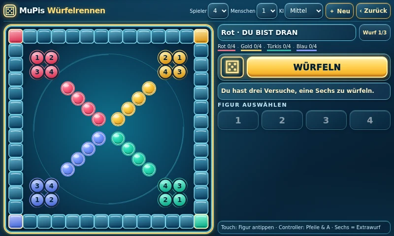

# MuPis Würfelrennen

Eigenständiges, offline spielbares Würfel-Brettspiel für 2–4 Spieler (Menschen und KI).
Optimiert für 800 × 480 Pixel, Touch und MuPiBox-Controller.

## Screenshots (aktuelle Version 0.2.8)

Weitere Spielansichten, darunter **Sechs/Pflichtausfahrt**, **laufende Partie**,
**Zielgang** und **Sieg**, stehen in der
[README direkt bei der Anwendung](../examples/mupi-wuerfelrennen/README.md).
Alle Bilder stammen aus Chromium mit legalen Spielzuständen des
unveränderten Spielcodes (keine Mockups). Erneut erstellen mit
`python3 tools/capture_mupi_wuerfelrennen_screenshots.py`.

Installationspaket ohne README und Screenshots bauen mit
`python3 tools/build_mupi_wuerfelrennen.py`.

## Spielregeln

- Alle vier Figuren starten im **Haus**. Mit einer **6** zieht eine Figur auf das
  eigene Startfeld. Ist das möglich, hat dieser Zug immer Vorrang; die Figur
  kommt automatisch heraus. Ein Gegner auf dem Startfeld wird geschlagen.
- Steht eine eigene Figur auf dem Startfeld, **muss sie bei nächster legaler
  Gelegenheit weiterziehen**, damit das Startfeld wieder frei wird. Ist genau
  dieser Zug blockiert, darf eine andere Figur ziehen.
- Wenn **keine Figur außerhalb des Hauses** mit einer Zahl von 1 bis 6
  einen legalen Zug machen kann, gibt es bis zu **drei Wurfversuche**.
  Andernfalls einen Versuch pro regulärem Zug.
- Eine **6 nach einem gültigen Zug** erlaubt einen weiteren Wurf.
- Eigene Figuren dürfen nicht auf demselben äußeren Feld stehen. Im privaten
  Zielgang dürfen eigene Figuren weder übersprungen noch überholt werden.
  Die Zielfelder 52–55 müssen mit genauer Augenzahl erreicht werden.
- Wer zuerst alle vier Figuren in seinen Zielgang gebracht hat, gewinnt.

## Steuerung

- **Touch:** „WÜRFELN“ antippen; danach eine erlaubte Figur antippen.
- **Controller:** A oder Start zum Würfeln, Pfeiltasten zur Figurwahl, A
  zum Ziehen, BACK zum Verlassen.
- Verfügbare Figuren sind optisch hervorgehoben. Bei einer Pflichtausfahrt
  nach einer Sechs wird die Hausfigur automatisch eingesetzt.

## Entwicklung

    node --test tests/community_board_games.test.cjs
    python3 tools/build_mupi_wuerfelrennen.py
    python3 tools/mupiapp.py validate dist/mupi-wuerfelrennen.mupiapp

Keine zusätzlichen Berechtigungen außer controller, keine Netzwerknutzung.

## Spielfeld-Design (Version 0.2.5)

Der Mittelpunkt enthält ein vollständig im runden Emblem liegendes,
vektorbasiertes, orangefarbenes MuPi-Gesicht mit genau drei Kiemenästen
je Seite und separatem MuPi-Schriftzug. Ein goldener Doppelring,
kontrastreichere Spielfelder, kräftigere farbige Zielwege und dunklerer
Brett-Hintergrund verbessern die Erkennbarkeit auf 800×480 Pixeln.
Es werden keine externen Bildressourcen oder neuen Berechtigungen benötigt.

## Mittelpunkt (Version 0.2.6)

Der Mittelpunkt zeigt statt des MuPi-Maskottchens einen kleinen, glänzenden
isometrischen Würfel mit elfenbeinfarbener Oberseite und dunkelblauen
Seitenflächen sowie goldenen Kanten. Die 5 liegt oben, die 3 und 1 auf
den sichtbaren Seiten: Die 2 ist die gegenüberliegende, unsichtbare
Unterseite der 5; alle gegenüberliegenden Würfelflächen ergeben 7.
Der Würfel wird in einer eigenen SVG-Hintergrundebene **vor** den
Spielzielen gezeichnet und liegt damit **hinter** den farbigen
Zielfeldern, Bewegungsmarkierungen und Spielfiguren. Die Spieldaten
und Regeln bleiben unverändert.

## Spielfeld-Geometrie (Version 0.2.7)

Die vier Start-Häuser stehen nun jeweils 8 SVG-Einheiten weiter außen.
Die Zielgänge bestehen aus vier kreisförmigen Feldern je Farbe, mit einem
diagonalen Schritt von 22 Einheiten in X und Y; benachbarte Kreise mit
Radius 14,1 überlappen dadurch nicht. Die vier innersten Zielfelder
bleiben ebenfalls voneinander getrennt. Der dekorative 3D-Würfel ist
zusätzlich verkleinert (SVG-Skalierung 0,73 statt 0,88) und weiterhin
hinter den Zielfeldern und Spielfiguren angeordnet. Die Zuglogik und
Positionen im Spielzustand bleiben unverändert.

## Glanz-Design (Version 0.2.8)

Die Dekoration in der Spielbrettmitte wurde komplett entfernt. Ein subtiler
atmosphärischer Lichtverlauf und eine transparente Ringlinie sorgen für einen
aufgeräumten Mittelpunkt. Die 52 Laufbahnfelder besitzen jetzt plastische
Blautöne und Lichtkanten, die vier Startfelder eigene Farbverläufe.
Die 16 getrennten, runden Zielfelder und die 16 nummerierten Spielfiguren
erhalten abgestimmte Hochglanzoberflächen. Der goldene Würfeln-Button und
die übrige Bedienoberfläche wurden ebenfalls optisch vereinheitlicht.
Der Würfel im **Bedienbereich** bleibt natürlich vorhanden und zeigt
wie bisher das Würfelergebnis. Alle Grafiken sind offlinefähige lokale
SVG- und CSS-Elemente ohne zusätzliche Berechtigungen. Die Spiellogik,
Touch- und Controllersteuerung bleiben unverändert.
