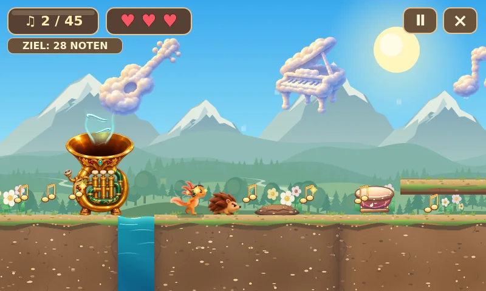
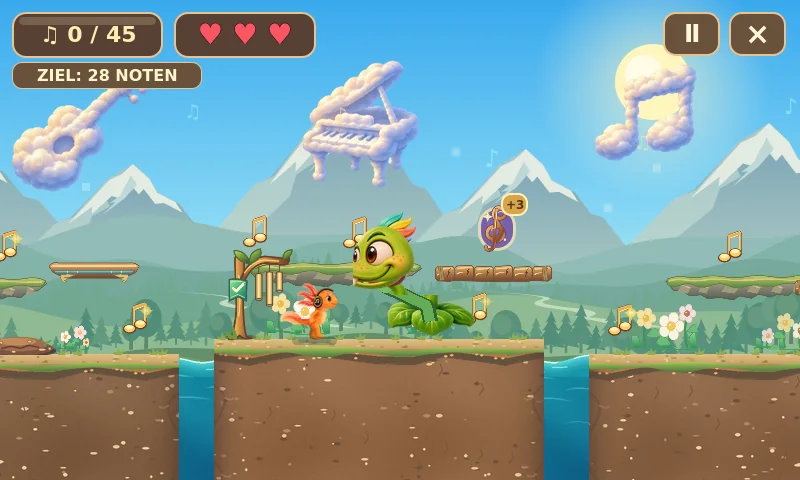
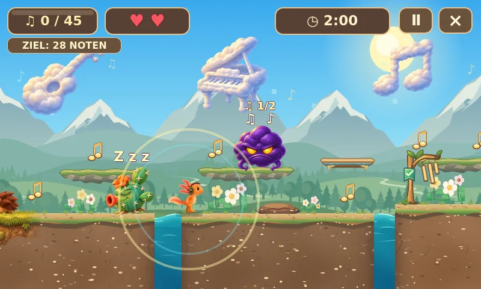
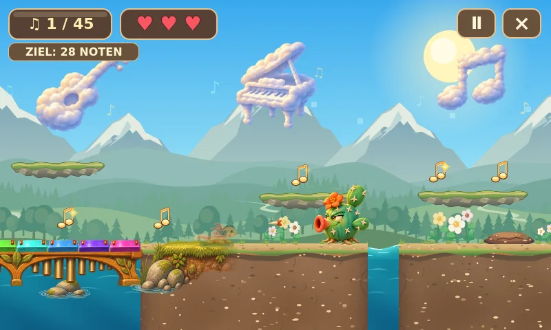
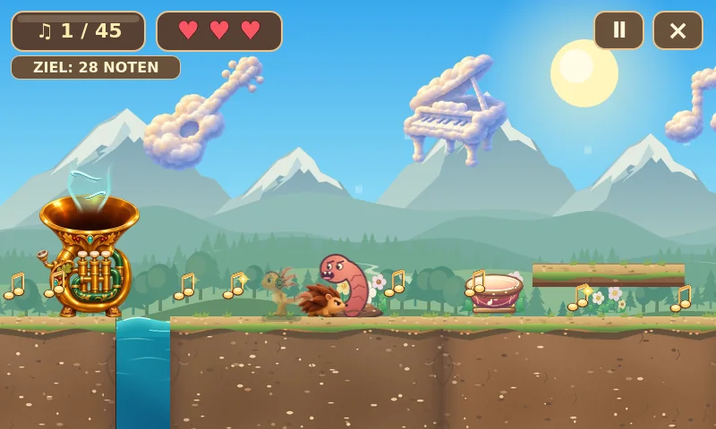
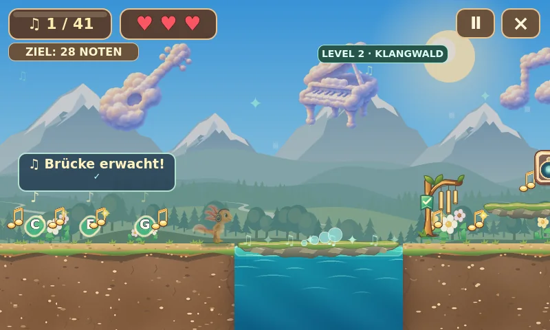
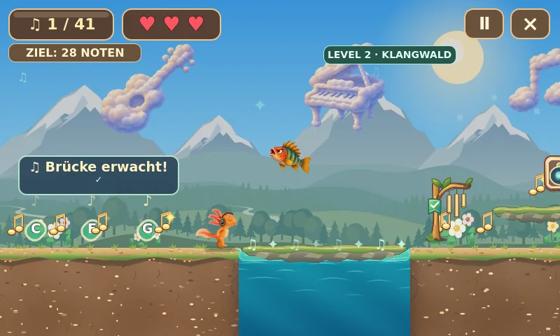
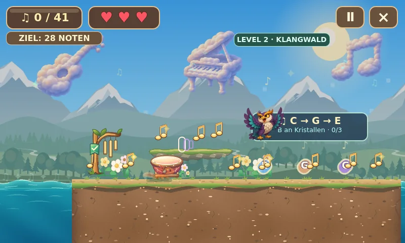

# MuPi und die verlorenen Noten

Sammle Noten, öffne Klangbrücken und bring die Musik zurück. Du findest das Spiel auf der MuPiBox unter **Community-Apps → Katalog**. Für den Start brauchst du einen Controller und die Freigabe der Qt-Laufzeit im Reiter **Sicherheit**.

## Level 3 · Klangbäume

Spring über 36 Äste und zwei Trommeln zum Gitarrenbaumhaus. Der Grollnebel
steigt unter dir in Wellen. Am Baumhaus erklingen beim Weitergehen auch die
Saiten, die du bei der Landung übersprungen hast. Nach der sechsten Saite
öffnet sich das Fenster und eine Bonusnote im Wert von drei Punkten schwebt an der Tür zu MuPi.
Mit mindestens **26 von 40 Punkten** endet das Level an der Tür.

Für einen Lauf mit allen Noten erhältst du je nach Schwierigkeitsgrad eine,
zwei oder drei funkelnde **Levelnoten** auf Leicht, Normal oder Schwer.
Die Levelwahl zeigt deine beste Wertung je Level.

## Level 4 · Grummels Gewitter

Regen, Blitze und Donner begleiten dich bis zu Grummel. Auf **Schwer** brechen
manche Plattformen unter MuPi weg. Die letzte Note beim Endgegner zählt drei
Punkte.

## Level 5 · Grummel-Rock

Lauf los, um die Musik und die Verfolgungsjagd zu starten. Die Töne des
E-Gitarren-Riffs geben die Plattformwechsel vor. Spring über Lücken und
Gegner oder betäube die Gegner mit der Klangwelle. Die obere und die untere
Route führen dich auf unterschiedlichen Wegen ans Ziel. Verpasste Noten
bleiben an ihrem Platz.

## Gegner und Klangwelle

Im ersten Level schaltest du die Klangwelle mit den Kopfhörern frei. Im Klangwald und in den Klangbäumen hast du sie von Anfang an. **Tippe B** für eine Klangwelle und **halte B** zum Sprinten. Eine Klangwelle wirkt in MuPis Nähe. Getroffene Gegner bleiben für eine kurze Zeit harmlos und können danach wieder angreifen.

| Gegner | Wo? | Angriff und Warnzeichen | Hilft die Klangwelle? |
| --- | --- | --- | --- |
| **Knurr-Igel** | Level 1 | Patrouilliert am Boden. Die Stacheln sind auch bei einer Landung von oben gefährlich. | **Ja.** Ein Treffer betäubt ihn. |
| **Schnappblatt** | Level 1, im Klangwald ab **Normal** | Ein leuchtendes Ausrufezeichen kündigt an, dass die Pflanze seitlich nach MuPi schnappt. Gefährlich ist das zuschnappende Maul. | **Ja.** Ein Treffer unterbricht das Schnappen. |
| **Tonfresser** | Level 1, im Klangwald auf **Schwer** | Schwebt hin und her. Berührung tut weh. Eine Anzeige über zähen Varianten zählt die Treffer mit. | **Ja.** Normale Tonfresser brauchen einen Treffer. Zähe Varianten in Level 1 brauchen zwei oder drei, mit höchstens sieben Sekunden zwischen den Treffern. Bis dahin zucken sie nur kurz zurück. |
| **Pieksekaktus** | Level 1 | Bläht sich kurz auf und schießt einen Stachel waagerecht auf MuPi. Ducken hilft gegen den Schuss. | **Ja, gegen den Kaktus.** Ein Treffer stoppt das Aufladen. Ein bereits abgefeuerter Stachel fliegt weiter. |
| **Wutwurm** | Level 1 | Ein Erdhügel beginnt zu wackeln, wenn du am Boden darüberläufst. Etwa **1,25 Sekunden** später kommt der Wurm heraus und schnappt nach MuPi. | **Ja, sobald der Hügel wackelt oder der Wurm herausragt.** Dann schläft er kurz ein. Tief im Boden erreicht ihn die Klangwelle nicht. |
| **Brüllbarsch** | Level 2 · Klangwald | Blasen steigen **1,4 Sekunden** vor dem Sprung auf. Beim Absprung hörst du ein Platschen. | **Ja.** Triffst du ihn in Reichweite, kannst du den Sprung schon während der Blasenphase verhindern oder in der Luft abbrechen. |
| **Schreieule** | Level 2 · Klangwald und Level 3 · Klangbäume | Bewacht ihren eigenen Abschnitt. Ein Ausrufezeichen warnt vor dem Schrei. Mit dem Schrei schickt sie eine Schallwelle los, unter der du dich ducken kannst. | **Ja.** Ein Treffer betäubt die Eule und lässt ihre Schallwelle verschwinden, auch wenn sie schon unterwegs ist. |
| **Eichhörnchen** | Level 3 · Klangbäume | Duckt sich kurz und springt zwischen zwei Ästen hin und her. Ein Zusammenstoß während des Sprungs kostet ein Herz. | **Ja.** Ein Treffer stoppt den Sprung und betäubt es kurz. |

## Screenshots aus dem Spiel

Die Aufnahmen zeigen die echte Qt-Spieloberfläche der Community-App **0.1.0-alpha.11** im Janbox-Test bei **800 × 480 Pixeln**. Die genannten Warnzeiten beziehen sich auf diesen Stand.

### Level 1

| Knurr-Igel auf Patrouille | Schnappblatt beim Zuschnappen |
| :---: | :---: |
|  |  |
| **Tonfresser nach dem ersten Treffer** | **Pieksekaktus mit fliegendem Stachel** |
|  |  |
| **Wutwurm aus dem Erdhügel** | |
|  | |

### Level 2 · Klangwald

| Die Blasen kündigen den Brüllbarsch an | Der Brüllbarsch springt |
| :---: | :---: |
|  |  |
| **Schreieule mit Schallwelle** | |
|  | |

[Zurück zur Übersicht der Community-Apps](../../README.md)
