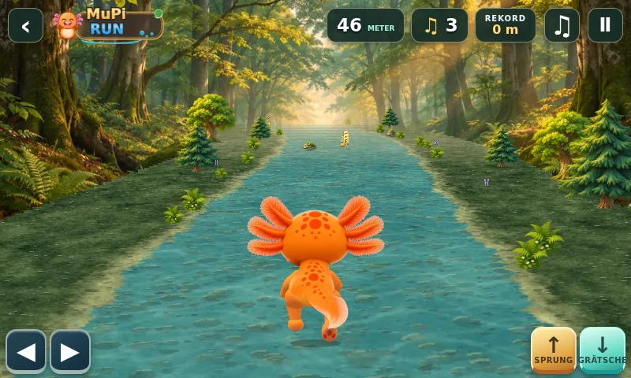
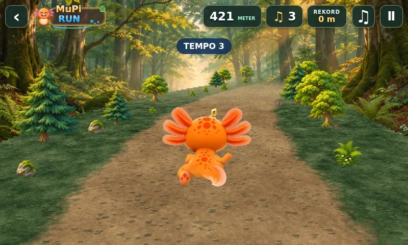
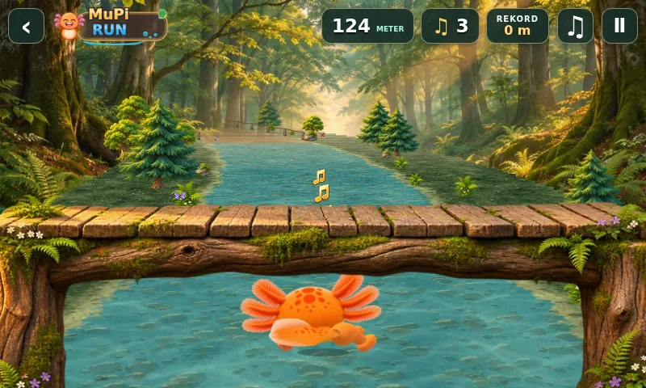

# MuPi Run 0.8.0

Sammle goldene Noten im Flussbett, auf dem Holzsteg und auf dem Waldpfad. Spring über den umgestürzten Stamm, grätsche unter dem Querbalken durch und wechsle die Spur, wenn ein Fuchs auf dem Weg schläft. Die Distanz bestimmt den Rekord. Die Noten zählen für den jeweiligen Lauf.

[Durchgehenden Lauf ansehen](mupi-run-screencast.mp4)

| Flussbett | Holzsteg | Waldpfad |
| --- | --- | --- |
|  |  |  |



## Steuerung

| Aktion | Controller | Tastatur | Touch |
| --- | --- | --- | --- |
| Spurwechsel | Steuerkreuz links/rechts | ← / → oder A / D | Pfeile oder horizontal wischen |
| Sprung | A / X / ↑ | ↑, W oder Leertaste | Sprungknopf oder nach oben wischen |
| Grätsche | B / Y / ↓ | ↓ oder S | Grätschenknopf oder nach unten wischen |
| Pause und Weiter | START | P | Pausenknopf |
| Verlassen | BACK / SELECT | Escape | Zurückpfeil oben links |

MuPi übernimmt beim Tastendruck die aktuell sichtbare der 24 Laufposen. Beide Aktionen haben 35 Bilder bei 30 FPS. Beim Sprung beginnt die Landung mit Bild 23, die tiefe Gleitphase liegt in den Bildern 9 bis 21, jeweils ab null gezählt. Figur und Schatten verwenden denselben Bodenanker. Die Sprunghöhe ist im Sprite enthalten. Der Lauf setzt mit dem zum letzten Aktionsbild passenden Bein wieder ein. Bei Pause bleibt die Pose stehen.

## Streckenaufbau und Grafik

Alle Streckenobjekte sind in Metern relativ zur Kamera platziert. Dieselbe Projektion bestimmt Spur, Tiefe, Größe und Kontaktpunkt. Der Boden wird streifenweise aus drei vorberechneten Texturen abgetastet. Ein Ring mit 16 wiederverwendeten Abschnitten hält nur die Umgebung in Sichtweite. Bäume, Steine, Farn und Schmetterlinge nähern sich mit der Strecke. Ein separater Zufallswert je Abschnitt bestimmt Position und Erscheinung. Schmetterlinge haben rote, violette oder gelbe Flügel und animierten Flügelschlag.

Notenreihen folgen in den Hinderniswellen einer passierbaren Spur. Animationsphasen für Goldreflex und Flügelschlag werden beim Start einmal gerendert. Das Spiel zeichnet die transparenten MuPi-Bilder aus sechs WebP-Seiten mit je 60 Kacheln. Jede Seite passt in eine 2048-Pixel-Textur. Das Paket enthält die verwendeten Grafiken lokal.

## Musik und Soundeffekte

Der Musik-Loop „Happy Trancin“ sowie Sprung, Grätsche und Notensammeln sind im Paket enthalten. Laufschritt und Kilometersignal sind für spätere Dateien vorbereitet. Urheber, Quellen, Lizenzlinks und die verwendeten Fassungen stehen in den [Audio-Credits](AUDIO-CREDITS.txt). Die Credits sind auch im Spielmenü einsehbar.

Eine Datei je belegtem Platz unter `examples/mupi-run/assets/audio/` ablegen und das Paket neu bauen. Geeignete Endungen sind `.ogg`, `.mp3` oder `.wav`. Unbelegte Plätze bleiben still. Der Builder erzeugt die Dateizuordnung aus dem tatsächlichen Paketinhalt.

| Dateiname ohne Endung | Auslöser |
| --- | --- |
| `music` | Musik-Loop während des aktiven Laufs |
| `run` | Ein kurzer Schritt pro halbem Laufzyklus |
| `jump` | Angenommener Sprung |
| `slide` | Beginn der Grätsche |
| `collect` | Einsammeln einer goldenen Note |
| `kilometer` | Einmal beim Überschreiten jeder 1.000-Meter-Marke |

Auf der Box verwendet die App die SDK-Funktionen für lokale Musik und Samples mit relativer Lautstärke. Im Browser übernimmt das Audioelement die Vorschau. Bei Pause, Fokusverlust, Spielende und Verlassen hält der Ton an. Der Stummschalter erscheint, sobald das Paket Audio enthält. Berechtigungen sind `storage`, `controller` und `audio`. Der vorhandene Distanzrekord bleibt unter `bestMeters` erhalten.

## Paket und Prüfungen

Im Repository-Stamm ausführen.

```sh
python3 tools/build_mupi_run.py
node --test tests/mupi_run.test.cjs tests/mupi_run_autopilot.test.cjs
python3 tests/mupi_run_sheet_test.py
python3 tests/mupi_run_sprite_test.py
python3 tools/capture_mupi_run_screenshots.py
python3 tools/record_mupi_run_screencast.py
```

Der Builder validiert `dist/mupi-run.mupiapp` mit dem Repository-Validator. Das Paket lässt sich im Pluginmanager manuell installieren. Screenshots und Screencast stammen aus Chromium bei 800 × 480. Die Galerie enthält auch gezielt eingestellte Testszenen. Der Screencast zeigt einen durchgehenden Lauf mit regulären Eingaben und dem aufgezeichneten Spielton.

Die drei Geländeabschnitte wurden im ausgepackten Installationspaket jeweils drei Sekunden in Headless-Chromium auf dem Entwicklungs-LXC gemessen (800 × 480, Software-Rendering). Der Median der Bildabstände lag bei 16,7 ms, das 95. Perzentil bei 16,7–16,8 ms. Eine Messung des nativen Qt-Webviews auf dem Raspberry Pi steht aus. Der automatisierte Logiklauf erreichte 1.264 m.

Die Aktionsatlanten lassen sich aus dem entpackten Originalpaket mit `python3 tools/import_mupi_run_actions.py PFAD_ZUM_AKTIONSPAKET` erneut erstellen. Für die Bodentexturen gibt es `python3 tools/render_mupi_run_ground.py` mit Pillow, NumPy und SciPy.

## Bildnachweise und technische Vorbilder

- **MuPi.** Lauf-, Sprung- und Grätschengrafiken stammen aus den für dieses Spiel bereitgestellten MuPi-Referenzen und Aktions-Spritesheets. Die MIT-Lizenz des Spielcodes umfasst die Rechte an MuPi als Figur nicht automatisch.
- **Waldkulisse und freigestellte Motive.** Waldpanorama, Fels, Stamm, Fuchs, Laubbaum, Farn, Tanne und Holzbrücke wurden für diese Version mit OpenAI-Bildgenerierung erstellt und für die Laufzeit zugeschnitten und komprimiert. Es wurden keine Grafikpakete anderer Spiele übernommen.
- **Weitere Projektgrafik.** Bodenmaterialien, goldene Doppelnote und die drei Schmetterlingsfarben sind projektspezifisch gerendert. Geländer, Zweige, Logo und weitere vorhandene Illustrationen stammen aus MuPi Run.
- **Wiederverwendung bewegter Elemente.** Unity erläutert am Runner *Trash Dash*, wie eingesammelte beziehungsweise aus dem Sichtfeld laufende Objekte für weitere Verwendungen bereitgehalten werden. [Unity Learn – Mobile Development Techniques](https://learn.unity.com/tutorial/mobile-development-techniques)
- **Streckenperspektive.** Phaser beschreibt die Projektion von Streckenabschnitten und seitlichen Objekten aus der Verfolgerkamera. MuPi Run berechnet seine Projektion selbst. Beide Quellen dienten als technische Referenz. [Phaser – Pseudo-3D road](https://www.phaser.io/packs/pseudo-road)
