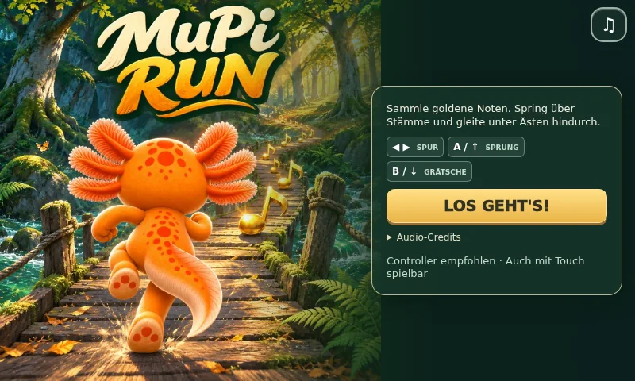
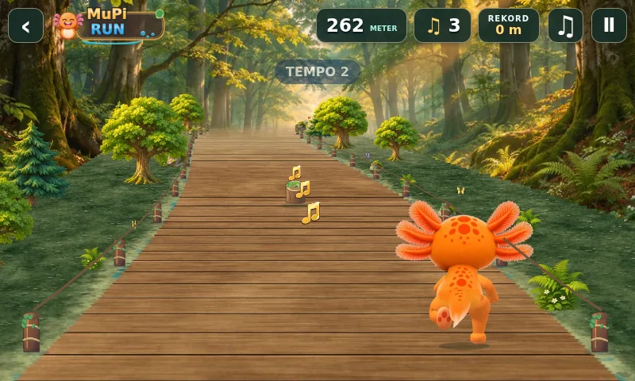

# MuPi Run 0.8.6

Sammle goldene Noten im Flussbett, auf dem Holzsteg und auf dem Waldpfad. Spring über den umgestürzten Stamm, grätsche unter dem Querbalken durch und wechsle die Spur, wenn ein Fuchs auf dem Weg schläft. Die Distanz bestimmt den Rekord. Die Noten zählen für den jeweiligen Lauf.

## Startbildschirm

MuPi folgt goldenen Noten über einen Holzsteg. Das quadratische Motiv erscheint auf der Home-Kachel und im Katalog. Im Startmenü liegen Schriftzug, Steuerung und Starttaste links, sodass MuPi rechts sichtbar bleibt. Wenn die Bildausgabe während des Laufs länger als eine Sekunde aussetzt, pausiert das Spiel. Mit „Weiterlaufen“ geht es an der letzten Position weiter.



[Durchgehenden Lauf ansehen](mupi-run-screencast.mp4)

| Flussbett | Holzsteg | Waldpfad |
| --- | --- | --- |
|  |  |  |


## Steuerung

| Aktion | Controller | Tastatur | Touch |
| --- | --- | --- | --- |
| Spurwechsel | Steuerkreuz links/rechts | ← / → oder A / D | Pfeile oder horizontal wischen |
| Sprung | A / X / ↑ | ↑, W oder Leertaste | Sprungknopf oder nach oben wischen |
| Grätsche | B / Y / ↓ | ↓ oder S | Grätschenknopf oder nach unten wischen |
| Pause und Weiter | START | P | Pausenknopf |
| Verlassen | BACK / SELECT | Escape | Zurückpfeil oben links |

MuPi übernimmt beim Tastendruck die aktuell sichtbare der 24 Laufposen. Beide Aktionen haben 35 Bilder bei 30 FPS. Beim Sprung beginnt die Landung mit Bild 23, die tiefe Gleitphase liegt in den Bildern 9 bis 21, jeweils ab null gezählt. Figur und Schatten verwenden denselben Bodenanker. Die Sprunghöhe ist im Sprite enthalten. Der Lauf setzt mit dem zum letzten Aktionsbild passenden Bein wieder ein. Bei Pause bleibt die Pose stehen.

## Streckenaufbau und Grafik

Alle Streckenobjekte sind in Metern relativ zur Kamera platziert. Dieselbe Projektion bestimmt Spur, Tiefe, Größe und Kontaktpunkt. Für jeden Bildpunkt des Bodens wird eine nach Entfernung vorgefilterte Textur abgetastet. Boden, Pflanzen, Geländer, Schmetterlinge und Sammelnoten werden in Tiefenreihenfolge in einen gemeinsamen Bildpuffer gezeichnet. Ein lokaler WebP-Atlas enthält die Motive in mehreren Größen. Am Bodenanker von MuPi übergibt die App den Bildpuffer an das Canvas und zeichnet anschließend die Figur und nähere Objekte. Die Spielwelt rendert mit bis zu 560 Pixeln Breite und 30 Bildern pro Sekunde. Bedienelemente und Anzeigen nutzen die Displayauflösung. Ein Ring mit 16 wiederverwendeten Abschnitten hält nur die Umgebung in Sichtweite. Bäume, Steine, Farn und Schmetterlinge nähern sich mit der Strecke. Ein separater Zufallswert je Abschnitt bestimmt Position und Erscheinung. Schmetterlinge haben rote, violette oder gelbe Flügel und animierten Flügelschlag.

Notenreihen folgen in den Hinderniswellen einer passierbaren Spur. Animationsphasen für Goldreflex und Flügelschlag werden beim Start einmal gerendert. Der Paketbau liefert sieben verlustfrei gepackte WebP-Seiten in Spielauflösung. Die App dekodiert die 384 Posen im Menü. Ein kleiner Zeichenpuffer übernimmt beim Posenwechsel nur das benötigte Rechteck. Der Boden verwendet vorberechnete Farbwerte. Die Simulation läuft in 60-Hz-Schritten. Nach jeweils zwei Schritten zeichnet das Spiel die nächste Pose. Sprung und Grätsche reagieren unmittelbar auf die Eingabe.

Die [Messungen auf zwei Raspberry Pi 4](benchmarks/pi4-2026-11-20.md) enthalten Startzeiten, einzelne Bildhänger und den Vergleich der Renderpfade.

## Musik und Soundeffekte

Ab NG 0.2.0-alpha.68 bereitet der native Player Sprung, Grätsche und Sammelton im Menü stumm vor. Beim Spielen verwendet er die dekodierten PCM-Daten erneut. Ältere Hosts spielen die Effekte wie bisher beim Auslösen ab.

Der Musik-Loop „Happy Trancin“ sowie Sprung, Grätsche und Notensammeln sind im Paket enthalten. Laufschritt und Kilometersignal sind für spätere Dateien vorbereitet. Urheber, Quellen, Lizenzlinks und die verwendeten Fassungen stehen in den [Audio-Credits](AUDIO-CREDITS.txt). Die Credits sind auch im Spielmenü einsehbar.

Eine Datei je belegtem Platz unter `examples/mupi-run/assets/audio/` ablegen und das Paket neu bauen. Geeignete Endungen sind `.ogg`, `.mp3` oder `.wav`. Der Paketbau benötigt FFmpeg und prüft die Grenzen des nativen Players. Jede Datei darf 1 KiB bis 2 MiB groß sein. Die Musik darf dekodiert bis zu 45 Sekunden dauern, ein Effekt bis zu 5 Sekunden. Der Builder erzeugt die Dateizuordnung aus dem tatsächlichen Paketinhalt.

| Dateiname ohne Endung | Auslöser |
| --- | --- |
| `music` | Durchgehender Loop ab dem Spielmenü |
| `run` | Ein kurzer Schritt pro halbem Laufzyklus |
| `jump` | Angenommener Sprung |
| `slide` | Beginn der Grätsche |
| `collect` | Einsammeln einer goldenen Note |
| `kilometer` | Einmal beim Überschreiten jeder 1.000-Meter-Marke |

Auf der Box verwendet die App die SDK-Funktionen für lokale Musik und Samples mit relativer Lautstärke. Im Browser übernimmt das Audioelement die Vorschau. Startmenü, Lauf, Spielpause, Ergebnis und neuer Versuch teilen sich denselben Musikloop. Stummschalten, Ausblenden und Verlassen stoppen den Ton. Menü und Lauf haben einen Stummschalter. Bei Browsern mit Autoplay-Sperre schaltet die erste Interaktion die Musik frei. Berechtigungen sind `storage`, `controller` und `audio`. Der vorhandene Distanzrekord bleibt unter `bestMeters` erhalten.

## Paket und Prüfungen

Im Repository-Stamm ausführen.

```sh
python3 tools/build_mupi_run.py
node --test tests/mupi_run.test.cjs tests/mupi_run_autopilot.test.cjs tests/mupi_run_timing.test.cjs
python3 tests/mupi_run_atlases_test.py
python3 tests/mupi_run_sheet_test.py
python3 tests/mupi_run_sprite_test.py
python3 tools/capture_mupi_run_screenshots.py
python3 tools/record_mupi_run_screencast.py
```

Der Builder validiert `dist/mupi-run.mupiapp` mit dem Repository-Validator. Das Paket lässt sich im Pluginmanager manuell installieren. Screenshots und Screencast stammen aus Chromium bei 800 × 480. Die Galerie enthält auch gezielt eingestellte Testszenen. Der Screencast zeigt einen durchgehenden Lauf mit regulären Eingaben und dem aufgezeichneten Spielton.

Ein separater Qt-WebEngine-Test auf einem Raspberry Pi 4 mit 1 GB RAM verglich beide Spielpakete bei 800 × 480 Pixeln. In jeder der drei Szenen wurden vier Sekunden mit Musik, Sammelnoten, Sprung und Grätsche gemessen. Der native Box-Decoder und Mixer liefen auf demselben Pi. Der Test verwarf die PCM-Ausgabe vor dem Lautsprecher. Die Bildrate zählt tatsächlich gezeichnete Spielbilder. Einzelne Bilder brauchten länger als das Ziel von 33 ms.

| Version | Flussbett | Holzsteg | Waldpfad |
| --- | ---: | ---: | ---: |
| 0.8.1 | 18,2 FPS | 17,3 FPS | 17,2 FPS |
| 0.8.2 | 25,4 FPS | 27,7 FPS | 26,9 FPS |

Den Landschaftsatlas generiert `python3 tools/prepare_mupi_run_scenery.py` mit Pillow aus den vorhandenen Motiven unter `art/`.

Die Aktionsatlanten lassen sich aus dem entpackten Originalpaket mit `python3 tools/import_mupi_run_actions.py PFAD_ZUM_AKTIONSPAKET` erneut erstellen. Die Projektionstabellen werden mit `python3 tools/prepare_mupi_run_road.py` aus den drei Geländetexturen erzeugt. Für die Bodentexturen gibt es `python3 tools/render_mupi_run_ground.py` mit Pillow, NumPy und SciPy.

## Bildnachweise und technische Vorbilder

- **MuPi.** Lauf-, Sprung- und Grätschengrafiken stammen aus den für dieses Spiel bereitgestellten MuPi-Referenzen und Aktions-Spritesheets. Die MIT-Lizenz des Spielcodes umfasst die Rechte an MuPi als Figur nicht automatisch.
- **Waldkulisse und freigestellte Motive.** Waldpanorama, Fels, Stamm, Fuchs, Laubbaum, Farn, Tanne und Holzbrücke wurden für diese Version mit OpenAI-Bildgenerierung erstellt und für die Laufzeit zugeschnitten und komprimiert. Es wurden keine Grafikpakete anderer Spiele übernommen.
- **Weitere Projektgrafik.** Bodenmaterialien, goldene Doppelnote und die drei Schmetterlingsfarben sind projektspezifisch gerendert. Geländer, Zweige, Logo und weitere vorhandene Illustrationen stammen aus MuPi Run.
- **Wiederverwendung bewegter Elemente.** Unity erläutert am Runner *Trash Dash*, wie eingesammelte beziehungsweise aus dem Sichtfeld laufende Objekte für weitere Verwendungen bereitgehalten werden. [Unity Learn – Mobile Development Techniques](https://learn.unity.com/tutorial/mobile-development-techniques)
- **Streckenperspektive.** Phaser beschreibt die Projektion von Streckenabschnitten und seitlichen Objekten aus der Verfolgerkamera. MuPi Run berechnet seine Projektion selbst. Beide Quellen dienten als technische Referenz. [Phaser – Pseudo-3D road](https://www.phaser.io/packs/pseudo-road)
