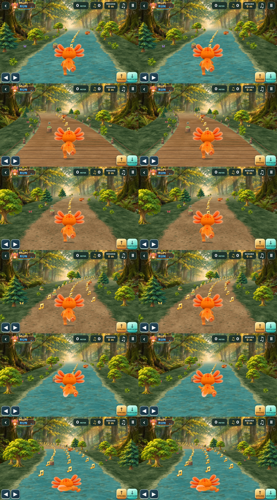

# MuPi Run 0.8.4 auf Raspberry Pi 4 · 20. November 2026

Zwei Pi 4 mit 1 GB RAM, Rev. 1.1 (Box 83) und Rev. 1.5 (Janbox), 955 MiB für Linux, kein Swap. Das Displayformat war 800 × 480, die Spielwelt 560 × 336. Beide produktiven Geräte liefen während der Messung weiter auf NG 0.2.0-alpha.67. Ein zweiter unprivilegierter Qt-Prozess lief je Versuch auf einer separaten, GPU-beschleunigten Weston-Ausgabe. Der isolierte Touch-Host nutzte die NG-Routen, den App-Sandboxrahmen, SDK und Audiomixer. Damit misst der Test auf dem Pi tatsächliche Spiel- und Qt-Frames. Der Scanout am physischen Display, Lautsprecherlatenz, GC-Pausen und die physische Controllerlatenz wurden nicht gemessen. Ein Pi 5 stand nicht zur Verfügung.

## Vollständige Durchläufe

Start ist die Zeit vom Qt-Prozessstart bis zur freigegebenen Starttaste. FPS zählt fertige Weltzeichnungen inklusive unmittelbarer Aktionsbilder. P95, P99 und Maximum sind Abstände zwischen aufeinanderfolgenden Weltzeichnungen innerhalb eines Szenenfensters. Start- und Endlücken pro Fenster stehen separat in den [Messdaten](pi4-trials.json). CPU umfasst Qt, Chromium und nativen Testhost, 100 % entsprechen einem Kern. PSS ist der höchste beobachtete proportionale Speicherverbrauch dieser Prozesse, inklusive Start. GPU gibt den Anteil der Zeit der beobachteten V3D-Render-Clients an. Die Geräte waren im normalen Betrieb, die Messwerte zeigen auch dessen Streuung.

| Gerät · Versuch | FPS | P95 ms | P99 ms | Maximum ms | >100 ms | Start s | CPU % | PSS MiB | GPU % |
|---|---:|---:|---:|---:|---:|---:|---:|---:|---:|
| 83 · 0.8.3 A | 21.72 | 49.3 | 149.3 | 8287.9 | 14 | 67.02 | 89.3 | 332.8 | 6.61 |
| 83 · 0.8.3 B | 21.6 | 45.2 | 106.4 | 9904.5 | 11 | 52.18 | 59.0 | 328.5 | 3.87 |
| 83 · 0.8.4 Kandidat A | 29.96 | 49.6 | 52.3 | 127.7 | 1 | 9.57 | 124.2 | 358.9 | 10.22 |
| 83 · 0.8.4 Kandidat B | 23.79 | 47.6 | 52.3 | 7730.5 | 1 | 8.82 | 99.2 | 358.8 | 7.97 |
| 83 · 0.8.4 Paket A | 27.14 | 44.4 | 52.0 | 3897.1 | 1 | 7.95 | 100.2 | 383.9 | 8.21 |
| 83 · 0.8.4 Paket B | 30.15 | 49.2 | 52.3 | 59.5 | 0 | 8.60 | 125.4 | 394.2 | 10.47 |
| Janbox · 0.8.4 Kandidat A | 29.86 | 48.8 | 53.9 | 165.6 | 1 | 18.43 | 112.7 | 352.7 | 8.94 |
| Janbox · 0.8.4 Kandidat B | 30.11 | 49.3 | 53.7 | 220.5 | 1 | 9.28 | 115.8 | 394.6 | 9.28 |

Der 0.8.3-Versuch auf Janbox erreichte das Menü innerhalb des 185-Sekunden-Zeitlimits nicht. Ein Audio-Bridge-Timeout ist protokolliert. Für diesen Versuch fehlen belastbare FPS. Die Kandidaten hatten dieselben kompakten Bildseiten und denselben Zeichenpfad wie das finale Paket. Für die Paketmessungen lag die Kachelzuordnung als separate lokale Datei vor.

Mit Qt-Swap-Messung auf Box 83 wurden über das gesamte Messfenster inklusive Szenenübergängen 12,46 → 31,67 Fensteraktualisierungen/s erfasst. Das P99 sank von 335 auf 58 ms. In den 11,36 s zwischen den beiden am weitesten auseinanderliegenden Qt-Swaps der alten Fassung stiegen auf dem gesamten Gerät die Zähler für Major Page Faults um 706 und für direkten Seitenscan um 9.817. Der freie CMA-Speicher erreichte im alten Versuch 0 KiB. Das ist ein Anhaltspunkt für Speicherdruck. Die Messung ordnet den Verursacher keinem einzelnen Prozess zu. Der neue Build hielt im ungünstigsten Kandidatenlauf ebenfalls 7,73 s an. Das Ziel dauerhaft gleichmäßiger 30 FPS bleibt offen.

## Die sechs Szenen auf Box 83

Die Tabelle vergleicht die beiden Versuche mit zusätzlich erfassten Qt-Swaps. Die JSON-Datei enthält auch alle übrigen Wiederholungen sowie die Anzahl der Intervalle über 33,3 ms, Prozesslast, Hintergrundlast und Temperatur.

| Szene | FPS 0.8.3 | FPS 0.8.4 | P95 alt / neu, ms | P99 alt / neu, ms |
|---|---:|---:|---:|---:|
| river | 4.85 | 30.43 | 272.0 / 36.4 | 9904.5 / 37.9 |
| boardwalk | 29.15 | 29.79 | 37.2 / 50.5 | 51.5 / 51.6 |
| forest | 30.25 | 29.29 | 37.5 / 50.4 | 45.2 / 53.1 |
| dense | 30.16 | 29.86 | 39.8 / 51.1 | 51.0 / 52.6 |
| actions | 27.38 | 30.13 | 82.4 / 51.3 | 115.3 / 53.2 |
| endurance | 29.54 | 30.4 | 42.5 / 40.6 | 57.1 / 50.4 |

## Renderpfade und Umsetzung

* Qt Quick und Qt WebEngine konnten auf beiden Pi 4 OpenGL ES 3.1 auf Broadcom V3D 4.2.14.0 mit Mesa 26.2.6 nutzen. Der Qt-Kontext meldete V3D, die DRM-Zähler erfassten echte Renderaufträge. Auch der laufende native EGLFS-Prozess auf Box 83 hatte den V3D-Renderknoten offen. Chromium meldete im separaten Prüfkontext beschleunigtes Compositing. WebGL für Community-Apps bleibt im Host deaktiviert. MuPi Run verwendet den CPU-Bildpuffer für die Straße und das GPU-beschleunigte Compositing der Ausgabe.
* **Zeittakt** in `logic.js` und `app.js`. Der Ansatz aus der Web-Portierung von „MuPi und die verlorenen Noten“ koppelt das Zeichnen an zurückgelegte Simulationsschritte. MuPi Run simuliert mit 60 Hz und zeichnet regulär jeden zweiten Schritt. Ein angenommener Sprung oder eine Grätsche zeichnet sofort. Mit unverändertem rechteckigem Atlas schwankte der vorherige Kandidat zwischen 24,12 und 30,11 FPS, der an die Simulation gekoppelte auf Box 83 zwischen 30,23 und 30,25. Diese kleine Stichprobe isoliert keinen allgemeinen FPS-Gewinn.
* **Figur** in `art/*.ready.webp`, `tile-layout.js`, `app.js` und `tools/prepare_mupi_run_atlases.py`. Der Build übernimmt die 384 Qualitäts-Skalierungen, entfernt transparente Ränder und hält Filterabstand zwischen den Kacheln. Sieben unveränderliche WebP-Seiten entsprechen dekodiert 23,97 MiB RGBA. Ein kleiner Zeichenpuffer enthält die aktuelle Pose. Der Originalpfad benötigte auf Box 83 52–67 s bis zur Startbereitschaft, das gemessene finale Paket 7,95–8,60 s. Der gesamte Prozess-PSS stieg dabei, wie die Tabelle zeigt.
* **Boden** in `world.js`. Nahe, vollständig deckende Bodenzeilen verwenden vorberechnete Schattierungen. Im instrumentierten Softwarelauf betrug die Bodenzeit einschließlich Hintergrund im Mittel 3,49 ms pro Bild, das Zeichnen der Objekte 1,67 ms. Nur der vollständige Renderpfad wurde für den Paketvergleich bewertet.
* **Alternativen** auf Box 83. Der Canvas-2D-Prototyp für die Straße erreichte 28,24 FPS bei P99 111,2 ms und 119,3 % CPU. Ein isoliert freigeschalteter WebGL-Prototyp mit Straßentextur, einem Dreiecks-Batch und Übergabe an den 2D-Pfad erreichte in fünf abgeschlossenen Szenen 8,50 FPS und P99 2.080,1 ms vor dem Timeout. Ein reiner Offscreen-Softwarelauf kam auf 29,68 FPS bei 244,9 % CPU. Er bildet keine Displayausgabe ab. Diese Versuche belegen keine allgemeine Grenze für einen vollständig GPU-basierten Renderer.
* **Audio** in `audio-session.js`, `assets/audio/` und der separaten NG-Änderung. Der Menüloop kann während der Grafikvorbereitung anlaufen. Die drei kurzen Effekte liegen im nativen 48-kHz-Mono-PCM-Format vor. Der Host lädt kanonische WAV-Dateien direkt, andere unterstützte Formate durchlaufen weiterhin den Decoder. Drei vorbereitete Effekte belegten zusammen 145.782 Bytes. Alt wurden drei externe Decoder gestartet, neu null. Bei 30 anschließenden hörbaren Signalverläufen im Testmixer gab es in beiden Versionen keine weitere Dekodierung. Der mittlere HTTP-Aufruf bis zur Übergabe an den Mixer dauerte 2,71 ms alt und 2,63 ms neu. Für den Musikloop wurde kein solcher PCM-Vergleich durchgeführt.

## Spielablauf und Bildqualität

Je Gerät lief ein separat instrumentierter Hindernislauf mit identischem Seed über 1.050,81 m. Beide erreichten 39 Noten, 30 Hinderniswellen, vier Sprünge, sechs Grätschen und sechs Spurwechsel ohne Kollision. Längste Bildpause in diesen beiden Läufen war 71,8 ms auf Box 83 und 280,8 ms auf Janbox. Ein Desktop-Browsertest des gepackten Spiels prüfte Start, Menüloop, Aktionen, Pause, Fortsetzen, Stummschalten, Ergebnis, Neustart und Verlassen. Die native Mischerausgabe wurde im Speicher nachgewiesen. Die Tests decken die akustische Wiedergabe am Gerät und einen echten Gamecontroller nicht ab.

Sechs native 800 × 480 Qt-Fensteraufnahmen wurden pro RGB-Kanal verglichen. Über alle Szenen lag die maximale Abweichung bei 1 von 255, die mittlere absolute Abweichung bei 0,00534–0,00673 von 255. Die Abweichungen liegen innerhalb der Figur. Die Bildpaare zeigen links 0.8.3 und rechts den kompakten 0.8.4-Kandidaten. Reihenfolge von oben: Flussbett, Holzsteg, Wald, dichte Szene, Sprung, Grätsche.

[Messverfahren und Aufruf](../../../tools/benchmarks/mupi-run/README.md)
