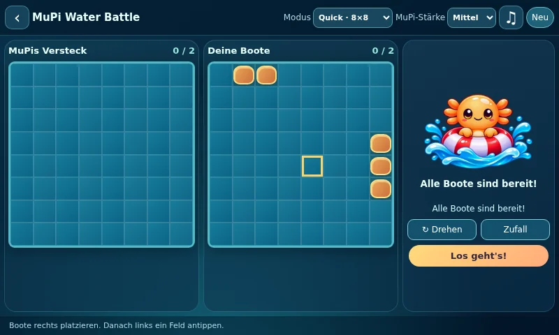
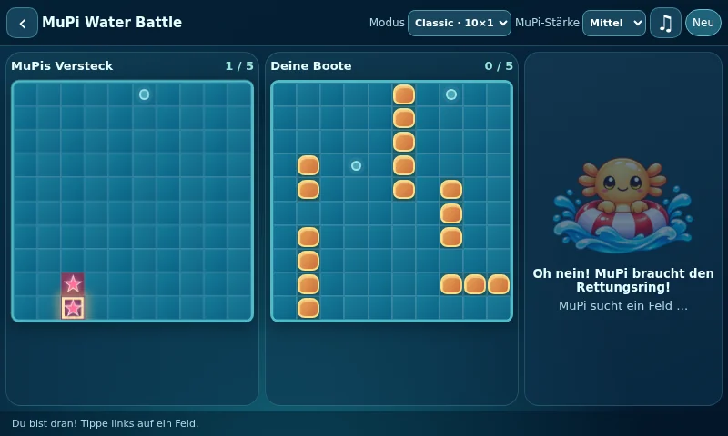
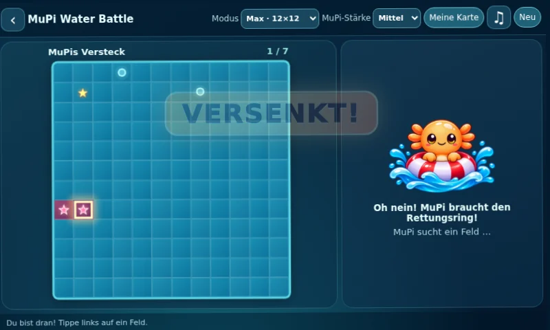
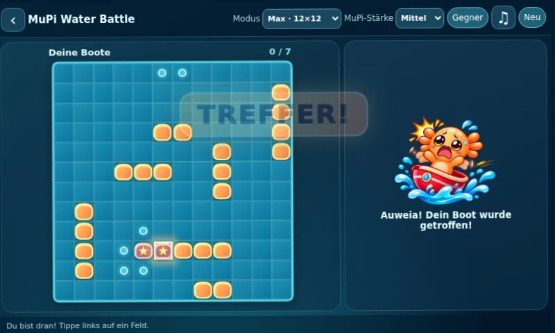
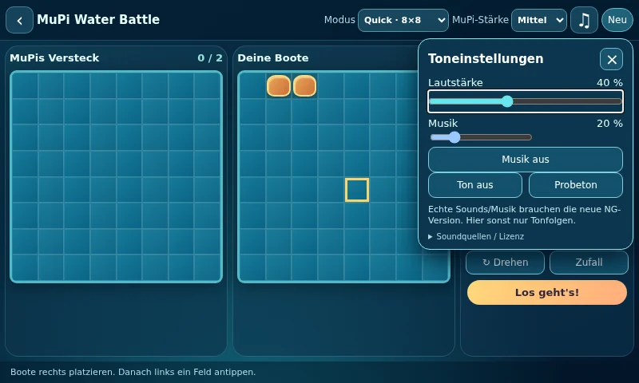
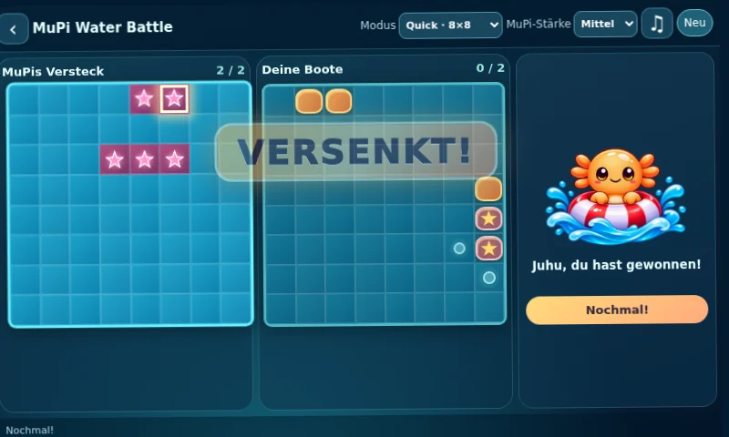

# MuPi Water Battle – Community App (0.2.6)

Eigenständig gestaltetes, kindgerechtes Offline-Suchspiel mit drei Modi: Quick 8×8 (2 Boote mit 3/2 Feldern), Classic 10×10 (5 Boote mit 5/4/3/3/2 Feldern) und Max 12×12 (7 Boote mit 5/4/4/3/3/2/2 Feldern). Keine Verbindung zu Hasbro, Battleship oder kommerziellen Ausgaben. Spiellogik, Bildschirmtexte und Illustrationen wurden eigenständig für MuPiBox erstellt. Die ausgewählten Audiodateien stammen von externen, in SOUND_CREDITS.txt genannten Urhebern und haben eigene Lizenzen.


## Screenshots (800 × 480)

Die folgenden Aufnahmen zeigen die **echte Web-Spieloberfläche** in der für die
MuPiBox vorgesehenen 5-Zoll-Auflösung. Sie wurden mit Chromium und
reproduzierbaren Touch-Eingaben erstellt (Browser-Vorschau, keine Aufnahme
von der Testbox).

| Quick – Bootsvorschau | Classic – ein Boot versenkt |
| :---: | :---: |
|  |  |
| **Max 12×12 – gegnerisches Spielfeld** | **Max 12×12 – eigene Flotte** |
|  |  |
| **Toneinstellungen** | **Spiel gewonnen** |
|  |  |

Screenshots bei UI-Änderungen neu erzeugen:

```bash
python3 tools/capture_waterbattle_screenshots.py
```

Erforderlich sind Chromium und Pillow (`PIL`). Der Generator erstellt das
installierbare App-Staging, spielt die Szenen im Browser durch und speichert
die optimierten WebP-Dateien unter `examples/mupi-wasserschlacht/screenshots/`.

## Spielen
1. Die eigene Karte wird groß angezeigt. Feld antippen, grüne (gültig) oder rote (ungültig) Vorschau prüfen, bei Bedarf **Drehen**, dann **Boot setzen** oder dasselbe Feld erneut antippen. Am Rand bleibt das Boot vollständig auf dem Feld. **Rückgängig** nimmt das letzte Boot zurück, **Zufallsflotte** platziert alle Boote automatisch. Boote dürfen sich auch diagonal nicht berühren.
2. **Los geht's!** drücken. Jetzt links ein unbekanntes Feld antippen.
3. Ihr und MuPi habt abwechselnd einen Zug. Treffer, Wasser und komplett aufgedeckte Boote werden markiert; die zuerst vollständig entdeckte gegnerische Flotte gewinnt.
4. Schwierigkeitsgrade: **Leicht** (Zufall), **Mittel** (Nachbarfelder nach Treffern), **Schlau** (Wahrscheinlichkeits-Suche). Keine der Varianten liest beim Zielen die verdeckten gegnerischen Boote.
5. Drei hochwertige freigestellte MuPi-Reaktionen: Wasser-Platscher, erschrockener orangefarbener MuPi im Boot und MuPi im Rettungsring. Versenkte Boote erhalten andersfarbige Sterne, Treffer einen besonders deutlichen eine Sekunde langen Bildschirm- und Spielfeld-Wackeleffekt mit leuchtendem Trefferlabel; die Animation startet bei jedem Treffer erneut (bei reduzierter Animation aus). Das Cover nutzt den orangefarbenen MuPi mit genau drei Kiemenästen je Seite. Die neuen Reaktionsgrafiken sind freigestellte PNG-Dateien statt der bisherigen, weiterhin als historische Vorlage vorhandenen SVG-Grafiken.
6. Die ausgewählten sechs Audiodateien sind lokal in `assets/audio/*.ogg` enthalten: Hintergrundmusik (20,5 Sekunden, überblendeter Loop), Wasser-Plopp, Treffer-Explosion, Versenkt, Gewonnen und Verloren. Die Lautstärke der Effekte und Musik lassen sich getrennt regeln, Musik ist abschaltbar; Einstellungen werden über die `storage`-Berechtigung gespeichert. Die Materialien und Lizenzen sind in `SOUND_CREDITS.txt` dokumentiert (Big Explosion CC BY 3.0: Blender Foundation). **Kompatibilität:** Auf NG-Versionen mit der neuen nativen `audio.sample.play`/`audio.music.play`-Bridge werden die ausgewählten OGG-Sounds und die Loop-Musik wirklich über die begrenzte PipeWire-Audioausgabe abgespielt. Ältere NG-Alphas unterstützen diese Bridge noch nicht; dort bleiben die bisherigen Note-Tonfolgen als Fallback, und die Hintergrundmusik ist nicht hörbar. Ein MuPiBox-NG-Update ist daher Voraussetzung.

## Auf dem 5-Zoll-Display
Optimiert für 800×480, Touch, Vollbild und eingebauten Zurück-Button. In der Aufbauphase wird in allen Modi nur die eigene Karte groß angezeigt. Im Max-Spiel wechselt der Ansichtsbutton zwischen Gegner und Meine Karte. Der native Header ist ausgeblendet, App-Hintergrund aktiviert. Controller: Steuerkreuz navigiert, **A** wählt, **X** dreht in der Aufbauphase, **Y** platziert die Boote automatisch (im laufenden Max-Spiel: Ansicht wechseln), **B** nimmt in der Aufbauphase das letzte Boot zurück (sonst verlässt es die App), **Start** beginnt bei vollständiger Flotte und **Zurück** verlässt die App.

## Installieren
Ab passender NG-Alpha mit Community-App-Manager:

    python3 tools/build_wasserschlacht.py

Danach dist/mupi-wasserschlacht.mupiapp im NG-Admin unter Community-Apps als Paket installieren und die Berechtigungen **controller**, **audio** und **storage** bestätigen. Die App arbeitet vollständig offline. Die App wird über den offiziellen Community-App-Katalog veröffentlicht; sie erfordert kein Backend.

## Tests
    node --test tests/mupi_wasserschlacht.test.cjs tests/waterbattle_audio.test.cjs

Quellcode: MIT-Lizenz des Community-Plugin-Repositories. Das grundsätzliche traditionelle Spielprinzip lässt sich unabhängig umsetzen; die konkrete Erscheinung kommerzieller Produkte, deren Markenzeichen und Grafikmaterial werden nicht übernommen. Für produktive Veröffentlichung sollte zusätzlich eine finale Marken-/Designprüfung erfolgen.

## Einheitliche Coverbilder

Das offizielle Community-App-Cover ist `cover.jpg`. Der Admin-Katalog erhält
über `catalog/apps.json` den kanonischen `icon`-Pfad
`examples/mupi-wasserschlacht/cover.jpg`. Auf unterstützten NG-Versionen
verwendet das Admin-Interface bei installierten Apps vorrangig das bereits
installierte `manifest.cover`, identisch zum Spiele-Coverflow.

## Sound- und Lautstärke-Fix 0.2.5

Das funktionslose Symbol neben dem Spieletitel ist entfernt. Auf Hosts mit audioVolumeControl ändern audio.music.volume und audio.sample.volume die Lautstärke ohne die Audiodatei erneut zu dekodieren oder den Hintergrundloop neu zu starten. Für den nativen Mixer ist ein NG-Update mit den beiden Methoden nötig. Änderungen am Slider werden begrenzt übertragen und beim Loslassen sofort übernommen. Der Host glättet die Pegel sowie das Ende der Musikschleife, um Knacken zu verringern.

## Aufbau und Audio 0.2.6

Die Musikdatei wurde für den nativen 48-kHz-Mono-Mixer neu aufbereitet: 120 ms komplementäre Überblendung am Loop-Übergang, abgesenkter Spitzenpegel mit Reserve für Effekte. Keine Änderung am SDK oder an Berechtigungen. Die Audioansteuerung vermeidet wiederholte identische Effektpegel-Updates und startet die Musik erst nach einer Spielaktion.
