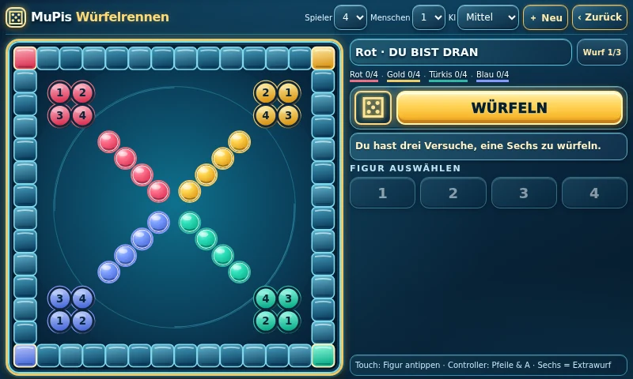
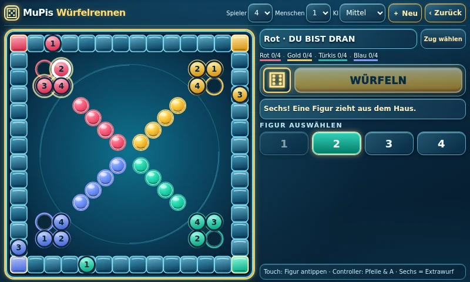
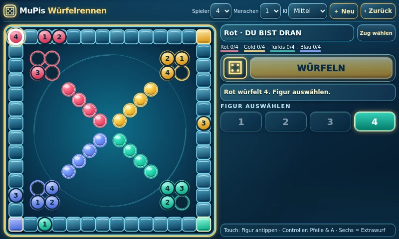
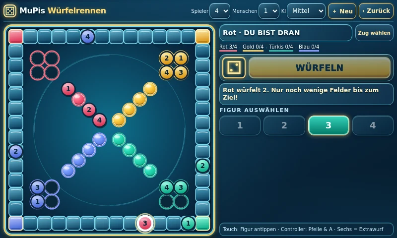
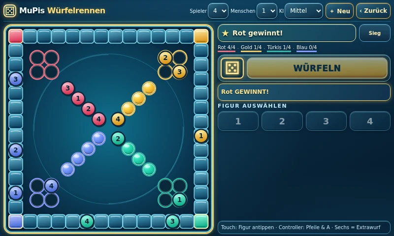

# MuPis Würfelrennen

Eigenständiges, offline spielbares Würfel-Brettspiel für zwei bis vier Personen
oder KI-Spieler. Die aktuelle **Hochglanz-Edition 0.2.8** kombiniert ein
goldgerahmtes Spielfeld mit 52 äußeren Feldern, vier Startbereichen und
16 getrennten, kreisförmigen Zielfeldern. Optimiert für die **5-Zoll-MuPiBox
(800 × 480 Pixel)** mit Touch- und Controllerbedienung.

## Screenshots (800 × 480)

Diese Bilder stammen direkt aus der **laufenden Community-Web-App v0.2.8**,
aufgenommen mit Chromium bei 800 × 480 Pixeln. Für die Spielsituationen
wurden nachvollziehbare Spielstände aus einer vollständig durch die
Spiel-Engine simulierten Partie verwendet. Es sind **keine KI-Mockups**
und **keine Fotos von der MuPiBox-Hardware**. Alle Screenshots liegen
direkt im Ordner dieser Anwendung.

| Start – vier Startbereiche | Sechs – Pflichtausfahrt |
| :---: | :---: |
|  |  |
| **Spielverlauf – Figur auswählen** | **Endspurt – Figuren im Ziel** |
|  |  |

### Gewonnen!



## Spielregeln

- Eine **6** bringt eine Figur verpflichtend aus dem Haus, sofern dies möglich
  ist. Eine gegnerische Figur auf dem Startfeld wird dabei geschlagen.
- Die eigene Figur auf dem Startfeld muss bei nächster legaler Gelegenheit
  weiterziehen; eine Blockade lässt einen anderen gültigen Zug zu.
- Wenn keine bereits ausgezogene Figur einen legalen Zug ausführen kann,
  gibt es bis zu **drei Wurfversuche**.
- Eine 6 nach einem gültigen Zug gibt einen **Extrawurf**.
- Eigene Figuren dürfen keine Felder doppelt belegen, und im Zielgang darf
  nicht über andere eigene Figuren gezogen werden. Der Zieleinlauf verlangt
  die passende Augenzahl.
- Wer zuerst alle vier Spielfiguren im eigenen Zielgang hat, gewinnt.

## Bedienung

**Touch:** „WÜRFELN“ drücken und eine zulässige Figur antippen. Bei
automatischen Pflichtausfahrten wird die Hausfigur vom Spiel gesetzt.

**Controller:** Pfeiltasten für die Figurwahl, A zum Würfeln bzw. Ziehen,
Start zum Würfeln und BACK zum Beenden. Unter „Spieler“, „Menschen“ und
„KI“ lassen sich Teilnehmerzahl und Schwierigkeit einstellen.

## Screenshots erneut aufnehmen

Die Screenshots sind reproduzierbar und zeigen regelkonforme Spielstände,
die direkt mit der aktuellen `app.js`-Spiellogik erzeugt werden.
Benötigt werden **Node.js**, **Chromium** und **Pillow**.

```bash
python3 tools/capture_mupi_wuerfelrennen_screenshots.py
```

Die fünf komprimierten WebP-Dateien werden im Verzeichnis
`examples/mupi-wuerfelrennen/` erneuert. Die Vorschau-Hooks existieren
ausschließlich während der Aufnahme in einem temporären Verzeichnis.
Das produktive Spiel enthält **keine** Testszenen oder Test-Hooks.

## Installationspaket

```bash
python3 tools/build_mupi_wuerfelrennen.py
python3 tools/mupiapp.py validate dist/mupi-wuerfelrennen.mupiapp
node --test tests/community_board_games.test.cjs
```

Der Builder schließt `README.md` und alle
`screenshot-*.webp`-Dateien ausdrücklich aus dem installierbaren
`.mupiapp`-Archiv aus, damit die Galerie keinen Speicherplatz auf der Box
belegt. Offizielle Katalogversion: **0.2.8**, Community Preview 50.
Die App benötigt nur die `controller`-Berechtigung, keine Netzverbindung.
Quellcode unter MIT-Lizenz.
